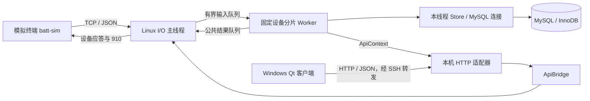

# 第三版开发计划：MySQL 存储迁移与 Qt 运维客户端

| 项目 | 内容 |
| --- | --- |
| 文档版本 | 1.0 |
| 编写日期 | 2026-10-28 |
| 文档状态 | 2026-10-29 已恢复；M0–M5 已实施和验证，M6 最终源码交付核验中，实际结果见第三版验收记录 |
| 现有基线 | batt-access V2 / 2.0.0，Git 提交 `224a608` |
| 目标版本 | V3.0：MySQL 服务端；V3.1：Qt 客户端与整体验收 |
| 开发方式 | 单人渐进开发；先完成存储迁移，再开发客户端 |
| 运行边界 | 单台 Linux 部署主机、单个服务实例、本机或 SSH 隧道运维、模拟终端验证 |
| 交付形式 | 源码、数据库脚本、构建与测试脚本、Qt 可运行客户端、操作教程、原始验收记录 |

> 本轮只执行“MySQL → 业务回归 → Qt”这条路线。Redis、离线补传、ROS2、音视频与新硬件接入不并行加入。文档描述的是目标方案，不代表已经完成迁移，也不授权删除旧数据库、升级旧虚拟机或发布代码。

## 1. 项目定位与建设目标

### 1.1 业务场景

模拟电池终端通过 TCP/JSON 登录并上报属性、告警。Linux/C++ 服务维护设备状态，保存告警和查询任务。运维人员通过 Qt 客户端查看单台设备状态、发起只读参数查询、读取任务结果并分页查看告警。

本轮引入 MySQL，练习客户端/服务器数据库访问、表结构、约束、事务、索引与异常处理；引入 Qt，为既有 HTTP 接口提供独立桌面客户端。两项均服务于现有业务，不以堆叠组件或提升未经测量的性能数字为目标。

### 1.2 交付目标

| 编号 | 目标 | 判断依据 |
| --- | --- | --- |
| G01 | 三类业务记录迁移至 MySQL | 设备、告警、查询任务由 MySQL 保存，服务端可启动和恢复 |
| G02 | 保持 V2 对外语义 | 设备协议、CLI、四类 HTTP 接口的成功、拒绝、重试与超时语义保持一致 |
| G03 | 明确存储故障行为 | 数据库异常时不发布无依据的成功；提交不确定时不盲目重发写事务 |
| G04 | 完成 Qt 单设备运维 | 状态、主动查询、告警三类操作可通过界面完成 |
| G05 | 保留工程证据 | 提供独立读库断言、网络/故障测试、复现操作与已知限制 |
| G06 | 开发者能独立解释核心路径 | 能画出正常操作、提交失败和响应丢失的时序，并定位相应源码 |

### 1.3 当前基线

现有项目已经具备：epoll LT 设备接入、固定设备分片 Worker、有界队列、Token 连接关联、SQLite 告警/任务持久化、HTTP 创建请求去重和告警游标分页。

现有属性只保留最新内存快照，不保存遥测历史。HTTP 默认不启用，启用后只监听 `127.0.0.1`。现有验收记录记载 V2 共 10 个 CTest 测试组；本文不将该结果视为 MySQL 或 Qt 版本已通过。

现有源码入口：

- [存储接口](../src/store.hpp)、[SQLite 实现](../src/store.cpp)。
- [业务执行与数据库边界](../src/worker.cpp)、[查询状态机](../src/query_task.hpp)。
- [HTTP 适配](../src/http_api.cpp)、[API 上下文](../src/api.hpp)。
- [第二版实施方案](第二版实施方案与验收清单.md)、[第二版验收记录](第二版验收记录.md)。

## 2. 范围与约束

### 2.1 本轮必做

1. 新建 MySQL 数据库结构、索引、约束和结构版本标识。
2. 实现 C++ MySQL 存储访问、参数绑定、RAII 和事务封装。
3. 迁移 `Store` 的设备登记、告警变化、查询创建/结束、历史读取与启动恢复。
4. 保留单实例、关键写事务串行协调和固定 Worker 所有权。
5. 将依赖 SQLite 的测试夹具改为 MySQL 版本，保留原业务断言。
6. 开发独立 Qt Widgets 运维客户端，通过既有 HTTP 接口访问服务。
7. 完成文档、故障演示、版本记录与可重复构建。

### 2.2 保持的行为

- 设备侧仍使用现有 TCP/JSON 协议、端口配置和模拟终端。
- I/O 线程负责设备 fd、网络收发与结果落实，不在运行期执行数据库查询。
- 同设备业务仍归属固定 Worker；Worker 不直接操作设备 socket。
- `110/111`、`310/311`、`410/411`、`910/911` 的业务含义保持。
- HTTP 应用等待默认 1 秒；设备查询默认 3 秒；二者不混同。
- 查询以 Worker 实际处理响应的时刻判定期限，终态不被迟到响应改写。
- 属性新鲜度默认 90 秒，连接在线不等于数据新鲜。
- 去重只保证同一数据库内仍保留的记录；不承诺终端操作恰好执行一次。

### 2.3 本轮明确不做

- Redis、通用连接池、自研 ORM、多个运行期数据库后端切换。
- 多实例、多机写入、主从复制、分库分表或微服务拆分。
- 遥测历史数据库、图表平台、终端离线缓存和补传。
- Web 页面、用户/租户系统、JWT、Qt 直连数据库或公网访问。
- ROS2、FFmpeg、RK、CAN、RS-485、FreeRTOS 与硬件联调。
- 自动导入旧 SQLite 历史、MySQL/SQLite 双写或跨数据库自动回滚。
- 高并发能力、性能提升比例、真实设备规模与生产上线承诺。

### 2.4 数据库后端选择

V3 交付一个 MySQL 后端。保留 `Store` 的业务方法，隐藏具体连接和语句类型，不预先搭建多后端插件系统。V2 的 SQLite 源码和数据库保留在基线版本/旧目录中，供对照与回退。

“存储后端迁移”与“旧数据搬迁”分开：本轮使用新建的 MySQL 测试库。若以后确需导入旧历史，另行编写导入计划，核对主键、请求号、告警生命周期、行数和下一自增编号。

## 3. 总体架构与线程边界



### 3.1 所有权

| 对象 | 所有者 | 约束 |
| --- | --- | --- |
| 设备连接、epoll、收发缓冲 | I/O 线程 | 由 I/O 执行连接操作 |
| Sessions、Queries、设备业务状态 | 对应 Worker | 不交给 HTTP 或 Qt 线程直接读取 |
| MySQL 业务连接与 prepared statement | 对应 Worker | 连接在线程中创建和释放，不并发共用 |
| 启动检查/恢复连接 | 启动线程，Worker 启动前 | 完成后关闭，不借给运行期 I/O |
| MySQL 客户端库全局初始化 | 进程主线程 | 在线程启动前初始化，所有连接关闭后清理 |
| Qt 控件与 QNetworkAccessManager | Qt GUI 线程 | 使用异步接口，不阻塞等待网络结果 |

首版每个 Worker 一个长连接，优先保持所有权简单。MySQL 连接共享存在同步限制；具体遵循 [MySQL 多线程客户端文档](https://dev.mysql.com/doc/c-api/8.4/en/c-api-threaded-clients.html)。

### 3.2 写事务协调

V3 首版保留进程内公共写协调锁，关键写事务按既有顺序提交。这是降低迁移并发变化的范围，不代表 MySQL 只允许一个写入者，也不作为数据库并行写优化成果。

约束仍由 MySQL 事务、外键、唯一索引和检查条件维护。读操作使用所属线程连接；不得带着写协调锁等待 socket、Qt 操作或结果队列空位。

移除公共写锁、增加数据库工作线程或连接池不属于本轮交付。若以后实施，必须另验跨设备事务冲突、死锁、唯一请求号竞争和提交顺序。

## 4. 环境、依赖与配置

### 4.1 环境方案

| 环节 | 目标环境 | 说明 |
| --- | --- | --- |
| 旧 V2 | 保留现有 Ubuntu 18.04 / SQLite 目录 | 不原地升级系统、编译器或数据库 |
| V3 服务端与 MySQL | 独立 Ubuntu 24.04 LTS 环境 | 初期使用独立新库，MySQL 仅本机访问 |
| 数据库 | MySQL 8.4 LTS、InnoDB | M0 记录准确补丁版本和配置 |
| C++ 客户端库 | MySQL C API，使用 C++ RAII 包装 | 锁定实际可用的客户端包版本，不混用未验证的兼容库 |
| Qt 客户端 | Windows，Qt 6 Widgets / Network / Test | M0 选定准确 Qt 小版本及配套编译器并记录 |
| C++ / 构建 | C++17、GCC、CMake；Qt 单独构建入口 | 不要求新旧环境的工具版本相同 |
| 测试读库 | 独立 Python MySQL 驱动 | M0 锁定驱动版本，测试不调用服务端 Store 来验证自身 |

这是环境目标，当前尚未安装或验证。M0 若存在兼容问题，应先记录并修订选型，再进入业务开发。

### 4.2 构建入口

现有根 [CMakeLists.txt](../CMakeLists.txt) 强制 Linux，不能直接用于 Windows Qt 客户端。

- 服务端继续使用根构建入口，接入 MySQL 依赖，V3 不再链接 SQLite 或生成旧 `batt-db`。
- Qt 使用独立的 `clients/qt/CMakeLists.txt`，可单独在 Windows 构建。
- 不因客户端加入而把整个 Linux 服务端强制依赖 Qt。
- 保留旧 V2 构建命令供基线版本使用；V3 单独提供教程。

### 4.3 数据库参数

拟新增 `--db-config <绝对配置文件路径>`，替换 V3 中的 SQLite `--db` 参数；给旧参数明确错误提示，不静默忽略。

配置至少包含：`host`、`port`、`database`、`user`、`password`、连接/读/写超时及固定 `runtime_dir`。连接地址首版为 `127.0.0.1`。

真实配置放在项目外或被忽略的 `.local/`；提交的示例只有占位值。密码不出现在命令行参数、日志、测试结果或 Qt 配置中。异常输出需要脱敏。

Qt 配置只包含本地 HTTP 基地址、设备 ID、刷新周期和客户端请求期限，不含数据库凭据。通过已有 SSH 本地转发访问 Linux 回环接口；Qt 不负责启动或管理 SSH 会话。

### 4.4 数据库会话设置

- 表统一使用 InnoDB；运行时核对所需结构版本。
- 数据库文本使用 `utf8mb4`；身份字段采用二进制存储/比较，详见第 5 节。
- 会话隔离级别明确设为 `READ COMMITTED`，事务使用显式开始、提交、回滚。
- 启用严格 SQL 模式，禁止将截断、非法值等问题静默转换为成功。
- 记录 `innodb_flush_log_at_trx_commit` 等实际持久化配置；目标值为 1。启用 binlog 时另核对其持久化配置，不把复制/断电验证纳入本轮。

## 5. MySQL 数据模型与约束

### 5.1 表结构映射

| 表 | 主要字段 | 关键要求 |
| --- | --- | --- |
| `device` | `dev_id`、`imsi`、`first_seen_ms`、`last_login_ms` | 设备唯一；重复登录保留首次时间 |
| `alarm` | `id`、`dev_id`、`event_no`、`alarm_id`、`alarm_desc`、`status`、起止时间 | 同设备事件号唯一，同告警最多一个 open 生命周期 |
| `query_task` | `txn_no`、`dev_id`、`connection_id`、`status`、`reason`、创建/结束时间、响应、请求号 | 同设备最多一个 pending，请求号全局唯一，终态不回退 |
| `schema_meta` | 应用标识、MySQL 结构版本、初始化完成标记 | 与业务版本和 SQLite user_version 分开管理 |

MySQL 首版结构版本记为 1，表示新的数据库结构序列，不沿用 SQLite 的 schema2。服务产品版本为 V3，与结构版本号不同。

### 5.2 类型和比较语义

- `txn_no`、`alarm.id` 使用有符号 `BIGINT AUTO_INCREMENT`；合法业务编号仍限制为 `1..INT64_MAX`，自增号允许有空洞。
- 时间沿用 UTC Unix 毫秒 `BIGINT`；运行期限继续使用 `steady_clock`，不从数据库墙上时间计算。
- `dev_id`、`imsi` 等现有标识按最多 64 字节处理。采用 `VARBINARY(64)` 保存身份字段，防止默认排序规则改变大小写、尾随空格或字节比较语义。
- `client_request_id` 使用可空 `VARBINARY(64)`；HTTP 请求号仍只接受原有 ASCII 字符集合；CLI 请求号为 SQL NULL。
- `connection_id` 使用足以容纳 `boot_id:token` 的二进制字段，至少 64 字节。
- `status` 使用明确的 ASCII 值并校验合法集合。
- `response_json` 首版使用可空 LONGTEXT，并校验有效 JSON；应用仍通过 JSON 库恢复对象。SQL NULL、缺失业务字段和空数组/空对象分别保留其原有含义。
- 所有二进制/文本参数传入明确长度，不用 `strlen` 推断业务字符串长度。

最终 DDL 在 M1 输出并逐项检查；此处是设计约束，不是已验证的建表脚本。

### 5.3 条件唯一约束改写

SQLite 的 `CREATE UNIQUE INDEX ... WHERE status=...` 不直接照抄。MySQL 首版采用“可空生成列 + 联合唯一索引”。下例为设计片段，实施时并入完整 DDL：

```sql
-- alarm 表：非 open 历史行的 guard 为 NULL，可保存多次生命周期
open_guard TINYINT GENERATED ALWAYS AS
  (CASE WHEN status = 'open' THEN 1 ELSE NULL END) STORED,
UNIQUE KEY one_open_alarm (dev_id, alarm_id, alarm_desc, open_guard)

-- query_task 表：非 pending 历史行不占用当前 pending 槽位
pending_guard TINYINT GENERATED ALWAYS AS
  (CASE WHEN status = 'pending' THEN 1 ELSE NULL END) STORED,
UNIQUE KEY one_pending_query (dev_id, pending_guard)
```

同时设置：`UNIQUE(dev_id,event_no)` 和 `UNIQUE(client_request_id)`，并保留设备外键与状态/结束时间相互匹配的检查条件。

必须分别测试：多条 cleared 历史可共存、同告警两条 open 被拒绝、多条终态查询可共存、同设备两条 pending 被拒绝、多个 NULL 请求号可共存。设计依据见 [生成列索引](https://dev.mysql.com/doc/refman/8.4/en/create-table-secondary-indexes.html)和 [MySQL 唯一索引语义](https://dev.mysql.com/doc/refman/8.4/en/create-index.html)。

### 5.4 读取索引

- 告警分页：`(dev_id,id)`。
- 告警状态过滤分页：`(dev_id,status,id)`。
- 请求号查任务：请求号唯一索引。
- 任务详情：`txn_no` 主键。

分页仍采用 `id < beforeId ORDER BY id DESC LIMIT limit+1`，不改成 OFFSET，不增加跨页一致快照承诺。

使用代表性测试数据保存 EXPLAIN。索引验证以实际执行计划为准，不承诺优化器在所有数据规模下必然选同一个索引。

### 5.5 初始化和版本管理

MySQL 许多 DDL 会引发隐式提交，不能复制 SQLite“所有 DDL 和恢复在一个事务中回滚”的保证。[MySQL 官方说明](https://dev.mysql.com/doc/refman/8.4/en/implicit-commit.html)

首版约定：

1. DDL 由显式初始化脚本在新库中执行；运行账号不自动建表或修改表结构。
2. 完整创建并检查结构后，最后写入 `schema_meta` 的完成标记。
3. 中途失败留下的库视为未初始化完成；服务拒绝启动，不尝试猜测性补齐。
4. 只有开发者自己创建的空测试库才能由测试脚本清理重建，脚本须验证库名前缀与用途。
5. 正常启动先验证应用标识、版本、表和约束，再执行旧 pending 的恢复 DML。
6. 未知库、版本不匹配或结构缺失时不开放监听。

## 6. 存储实现、事务与错误处理

### 6.1 实现结构

保留 `Store::login/alarms/create_query/create_api_query/finish_query/task/alarm_page/recover_devices` 等业务入口。使用 PImpl 或实现文件隔离 MySQL 头文件，不让设备状态机依赖 `MYSQL*`。

建议拆分的职责：

| 组件 | 职责 |
| --- | --- |
| `StoreOptions` / 配置解析 | 检查数据库参数，保存业务无关的连接信息 |
| `MysqlConnection` | 连接创建、会话配置、关闭、错误码提取 |
| `MysqlStatement` | prepare/bind/execute/fetch、NULL 与长度、结果释放 |
| `MysqlTransaction` | 显式事务，成功提交，异常时尽力回滚 |
| `Store` | 设备、告警、任务与恢复的 SQL 业务操作 |

RAII 对象禁止不安全复制；移动行为与句柄释放有明确规则。连接、语句、结果集按照依赖顺序析构，禁止在连接销毁后再释放依赖它的语句。

### 6.2 必须保持的事务边界

| 操作 | 数据库与内存顺序 |
| --- | --- |
| 登录 | 计算候选会话；提交设备登记及必要的旧 pending 结束；发布正式会话；允许成功 111 |
| 告警 | 计算目标设备候选集合；整帧变化提交；发布集合；允许成功 411 |
| 属性 | 仍只在内存校验与接纳；311 不增加持久化保证 |
| 新查询 | 创建任务并提交；发布任务缓存；才安排发送 910 |
| 查询成功/超时/断开 | 先提交终态；再更新缓存和展示结果 |
| 启动恢复 | 持锁、结构验证后，将旧 pending 在 DML 事务中结束为 server_restart；恢复完成后才启动监听 |

设备档案与 open 告警从库恢复；设备先 offline，属性重新采集，旧 pending 不自动重发。

### 6.3 HTTP 创建请求去重

事务入口保持“先识别已有请求号，再应用 busy/not_found 等创建判断”：

1. 同号同设备：返回已有任务当前记录，200，不新建、不再发 910。
2. 同号不同设备：409 `request_id_conflict`，不改原任务。
3. 新号且业务可创建：任务与请求号同一 INSERT、同一事务提交，201。
4. 新号被业务拒绝：不预占请求号。

公共写协调锁保留，但唯一约束仍必须存在。正常重复/业务冲突映射为明确结果，不能穿过致命存储异常路径导致停服。

SQL 冲突处理要识别具体约束与上下文，不能把所有重复键都解释为合法重试。账号、字段和超时错误也不能吞掉。

### 6.4 SQLite 与 MySQL 需要分别处理的行为

- 自增号不要求连续；读取本连接的插入编号并核对有符号范围。
- 不直接用 MySQL `INSERT IGNORE` 替代所有 SQLite 忽略插入，以免掩盖非重复数据错误。
- 普通 UPDATE 写入相同值时，MySQL 受影响行数可能为 0；不能把所有 0 行结果当作记录消失。
- `WHERE status='pending'` 的终态更新需要单独核对实际状态，不能放宽为任意历史行覆盖。
- 字段大小写、尾随空格、UTF-8 和 NULL 行为要有独立测试。
- MySQL 库连接、表和账号有独立生命周期，不能继续依赖本地数据库文件是否存在判断初始化状态。

### 6.5 错误分类

| 类别 | 首版处理 |
| --- | --- |
| 参数错误、未知设备、busy、请求号冲突 | 普通业务结果；服务继续运行 |
| 已识别的合法同号重试 | 读取原任务；服务继续运行 |
| 连接建立失败、权限错误、结构错误 | 启动失败，不开放监听 |
| 运行期 SQL 错误、锁等待超限、死锁 | 尽力回滚，记录分类与错误码，传播存储失败，停止受理并非零退出 |
| COMMIT 期间连接丢失 | 视为提交结果可能未知；不发布未经确认的成功，不盲目重放整个写事务；失败退出后按持久化记录恢复 |

首版不自动重试写事务，也不在故障连接上透明重连继续同一事务。死锁与锁等待记录需要清楚，后续如增加重试，须单独定义可重放范围、次数和期限。MySQL 死锁说明见[官方文档](https://dev.mysql.com/doc/refman/8.4/en/innodb-deadlocks-handling.html)。

“尽力回滚”不表示网络断开后已经证明没有提交。HTTP 超时/断开同样不能作为未创建证据，客户端仍用同一请求号查询或重试。

### 6.6 时间预算

初始配置建议：连接超时 2 秒；读/写网络超时各 1 秒；InnoDB 行锁等待 1 秒；应用写协调锁等待预算 500ms。M0/M4 根据实际客户端实现和故障结果核对，并将有效值记录到教程。

这些设置作用范围不同，不构成整个 SQL 操作的 500ms 硬截止。不得将 SQLite 的 busy/progress 回调原样写成 MySQL 的全操作取消保证。参见 [mysql_options 超时选项](https://dev.mysql.com/doc/c-api/8.4/en/mysql-options.html)。

HTTP 应用 1 秒和设备查询 3 秒规则保持；数据库等待可以消耗这些期限。正常退出保留有期限排空与 unfinished 记录；不可中断 I/O 与线程回收不作硬实时承诺。

## 7. 单实例、启动顺序与恢复保护

### 7.1 首版排他范围

本轮部署限制为：MySQL 和服务端在同一台 Linux 主机；所有服务启动使用同一 Unix 用户、同一个固定绝对 `runtime_dir`，通过该目录中的 schema 对应锁文件持有 `flock`。

- `runtime_dir` 必须先规范化为绝对目录，不能随工作目录变化。
- 测试中相同数据库但不同工作目录启动，也必须命中同一把锁。
- schema 名称限制为约定的 ASCII 标识；不接受任意 SQL 标识符拼接。
- 持锁文件不在运行期间删除，避免 inode 改变绕过排他。
- 锁从恢复前持有到所有 Worker 结束并释放连接后。
- 不宣称该方案能阻止不同主机、不同账号或绕过启动约定的程序写同一库。

MySQL 版不能再以 SQLite 文件路径构造锁。跨主机排他、命名锁监控与失效后的 fencing 不属于本版范围，禁止借 MySQL 后端扩展为多服务实例部署。

### 7.2 启动流程

1. 解析配置、验证固定运行目录并获取本机实例锁。
2. 在主线程初始化 MySQL 客户端库。
3. 使用短生命周期启动连接检查库、表、版本与配置。
4. 执行旧 pending 恢复事务，成功后关闭启动连接。
5. 启动 Worker；各线程创建并配置自己的连接、恢复所属设备。
6. 等待所有 Worker ready；任何一项失败都取消启动并回收。
7. 最后开放设备和可选 HTTP 监听，输出 ready。
8. 退出后先 join Worker/关闭全部连接，再清理客户端库与实例锁。

## 8. HTTP 与 Qt 交互契约

### 8.1 沿用的四类接口

| 接口 | Qt 操作 | 结果规则 |
| --- | --- | --- |
| `GET /v1/devices/{devId}` | 查看单设备状态 | 已登记但 offline 与未知设备 404 分开 |
| `POST /v1/queries` | 创建只读查询 | 201 新任务；200 重放；409 busy/冲突；503 需检查 outcome |
| `GET /v1/queries/{txnNo}` | 查看任务进展和终态 | 从持久化记录读取，不直接读 Worker map |
| `GET /v1/alarms?devId=...` | 查看告警 | 沿用 status/limit/beforeId，末页 nextBeforeId 为 null |

本轮不增加跨分片设备列表 API。Qt 先手工输入设备 ID；不为界面效果额外加入一套设备发现功能。

### 8.2 Qt 页面

| 页面 | 必做内容 | 边界 |
| --- | --- | --- |
| 连接与设备状态 | HTTP 地址、设备 ID、刷新/停止刷新、四项属性、状态与数据年龄 | 旧结果要能标记；网络失败不等于设备已离线 |
| 主动查询 | 创建、显示请求号/任务号、任务状态、reason、完整结果、同号重试 | 201 不显示为“设备查询成功”；超时未知结果不能换号盲重试 |
| 告警记录 | open/cleared/全部筛选、表格、下一页、重置分页 | 改设备或筛选重置游标；空页与请求失败分开 |

可以在一个主窗口中用三个区域或页签完成，不要求复杂美化、曲线、地图或多设备大屏。

### 8.3 客户端实现建议

- `ApiClient`：封装 HTTP、JSON、错误解析与请求超时。
- `DeviceViewModel`：当前设备、刷新结果及展示状态。
- `QueryController`：请求号、任务号和任务轮询状态。
- `AlarmTableModel`：告警行及分页游标；初版也可用简单表格，保持数据与网络代码分离。
- `MainWindow`：控件与用户操作，不直接包含 SQL 或服务端状态机。

使用 Qt Widgets、Network 和定时器，HTTP 调用采用 `QNetworkAccessManager` 异步接口；不在槽函数里同步等待、不使用循环嵌套事件处理来伪装异步。[Qt 官方说明](https://doc.qt.io/qt-6/qnetworkaccessmanager.html)

首版默认不创建专门网络线程。`QNetworkAccessManager`、reply 与定时器在 GUI 线程内正确管理；reply 完成/取消后按 Qt 规则释放，窗口销毁时停止定时器并处理未完成请求。

### 8.4 请求关联、刷新与编号

- 状态自动刷新建议 2 秒；每类周期操作最多一条在途请求，上一条未完成时不再无限追加。
- 客户端单次 HTTP 请求期限建议 3 秒；任务轮询间隔建议 500ms，最多自动观察 10 秒，达到观察期限后停止轮询并显示“观察超时/结果待确认”，不把服务端任务改写为 timeout。
- 切换设备、HTTP 地址或筛选条件时递增页面 generation；晚到响应不得覆盖新页面结果。
- 主动新建查询生成新的 UUID 请求号；同一次创建的重试保留原号。
- `outcome=unknown`、传输失败或丢响应时，保留请求号和关联上下文，提供同号重试。
- 任务一旦返回编号，后续优先 GET 任务；创建被明确拒绝与结果未知分别展示。
- 任务号和告警游标允许到 INT64_MAX。Qt 的 JSON 数字转换不能未经检查地当作 double 使用；解析到整数后以 qint64/十进制字符串保留，禁止静默舍入。M0 验证实际 Qt 版本，并用 `9007199254740993` 等值测试。
- 设备 ID 放入 URL 路径或查询参数时进行正确编码，JSON 参数使用标准序列化。

### 8.5 展示规则

当前属性没有历史入库，Qt 只展示最新快照，不画成已有历史数据库。重启后的设备应为 offline 或等待采集，不能保留旧绿色“在线且新鲜”状态作为实时结论。

SQL 与网络错误展示可理解的信息及可关联编号，不向界面泄露账号、密码、完整内部 SQL 或堆栈。

## 9. 拟改动文件与产物

下列新增路径为计划，当前尚不存在；实施时可按职责小幅调整并更新文档。

| 位置 | 计划 |
| --- | --- |
| `src/store.hpp`、`src/store.cpp` | 保留业务入口，切换为 MySQL 实现，隔离后端类型 |
| `src/mysql_raii.hpp/.cpp` | 连接、语句、结果、事务的最小资源封装 |
| `src/db_config.hpp/.cpp` | 数据库配置、字段校验、脱敏 |
| `src/access.cpp`、`src/worker.cpp` | 配置、初始化、实例锁、连接生命周期、错误传播适配 |
| `CMakeLists.txt` | 查找并链接 MySQL 客户端，移除 V3 的 SQLite 工具依赖 |
| `database/mysql/001_init.sql` | 新库完整 DDL 和初始化版本标记 |
| `config/mysql.example.ini` | 无真实凭据的配置示例 |
| `scripts/init-mysql.sh` | 明确目标的初始化入口，不自动删除已有库 |
| `scripts/test-mysql.sh` | MySQL 环境检查、构建与 CTest 入口 |
| `tests/mysql_probe.py` | 独立读库与受控测试夹具 |
| `tests/store_test.cpp`、`tests/api_test.cpp` | 存储/API 单测改为 MySQL 测试库 |
| `tests/persistence_test.py`、`tests/http_test.py` | SQL 断言、故障和恢复测试适配 |
| `scripts/demo-final.py`、`scripts/demo-http.py` | MySQL 版本演示，使用独立测试库 |
| `clients/qt/` | 独立 CMake 工程、界面、ApiClient、客户端测试 |
| `docs/第三版操作与测试教程.md` | 环境、建库、启动、SSH、Qt 使用与复现 |
| `docs/第三版验收记录.md` | 实际结果、命令、版本、失败与修复证据 |

生成物输出到已有忽略目录，例如根 `build-*`、`artifacts/`、`.local/`。Windows Qt 构建也显式使用这些目录，避免 Qt Creator 默认 build 目录被误提交。

## 10. 分阶段工作计划

所有阶段状态初始为“未开始”。阶段验收通过后再进入下阶段，不用完成代码行数或观看课程数量作为进度。

### M0：基线与环境准入

任务：

- 记录 V2 提交、旧目录和原数据库位置；后续开发使用单独分支/目录，保留可回退基线。
- 复现一次 V2 正常流程；记录结果，不能直接复制历史验收为本次结果。
- 建立独立 V3 Linux 环境，验证 MySQL Server/C API、编译器、CMake 与 Python 驱动。
- 在 Windows 验证 Qt 小窗口和异步 HTTP 请求，锁定 Qt/编译器版本。
- 选定固定运行目录、测试库前缀、配置存放位置及实际超时参数。

退出条件：环境记录齐全；最小 C++ 程序可连接 MySQL、参数化写入并读取；最小 Qt 程序可异步请求测试 HTTP；不影响旧 V2。

产物：环境清单、连接示例、Qt 最小样例、版本与基线记录。

### M1：数据库结构与约束

任务：

- 编写完整 DDL、索引、约束、版本标识和无凭据示例。
- 以独立 SQL 验证 pending/open/requestId 三类唯一规则。
- 验证大小写、NULL、64 字节边界、外键、非法状态与 JSON。
- 验证初始化中断、未完成结构、错误版本时服务的拒绝策略。

退出条件：结构审查通过；表与约束可复现；没有依赖普通 VARCHAR 默认排序规则的身份冲突。

产物：DDL、结构说明、SQL 夹具与预期结果。

### M2：MySQL 访问与事务封装

任务：

- 实现配置解析和最小 RAII 资源封装。
- 实现参数绑定、NULL/长度、结果取回、错误码与脱敏。
- 验证显式提交、回滚和资源释放。
- 明确全局库初始化、线程连接创建/释放和退出顺序。

退出条件：独立测试覆盖字符串/数值/NULL/大编号、异常路径释放和事务回滚；未让 I/O 线程承担运行期数据库调用。

产物：MySQL 基础封装及有意义的资源/事务测试。

### M3：业务存储迁移

按顺序实施：设备登记 → 告警变化 → 查询任务 → HTTP 去重 → 历史读取 → 启动恢复。

每迁移一个操作，都核对原内存发布时刻和 ACK 含义。同步适配启动参数、实例锁和根构建入口，V3 只使用 MySQL 后端。

退出条件：四类协议及四类 HTTP 的正常路径通过；同号重放在 busy 判断之前；新登录与旧 pending 结束仍为同一事务；同一库第二个服务拒绝启动。

产物：可运行 MySQL 服务端、启动教程和演示。

### M4：故障回归与 V3.0 门槛

任务：

- 适配原持久化/API 测试；独立读库，不用实现代码验证自身。
- 验证提交前/事务中/提交后进程故障、数据库断连、锁等待、请求号冲突。
- 保留测试失败原始记录及修复说明，不为通过测试降低事务语义。
- 完成 Debug 和检测构建；外部 MySQL 服务进程与预编译客户端库的检测范围分别说明。
- 保存一次代表性 EXPLAIN 和同场景功能/资源基线。

退出条件：第 11 节 MySQL 必测项全部通过；受控故障均有明确结果；无关键成功先于提交；没有把未知提交解释为已回滚。

产物：V3.0 验收记录；之后才开始完整 Qt 客户端。

### M5：Qt 客户端与接口联调

按顺序实施：手动 GET 状态 → 异步刷新与错误展示 → POST/GET 查询任务 → 同号重试 → 告警表格和分页。

验证页面切换、窗口关闭、晚到响应和大编号精度。以真实服务完成演示，同时用受控假 HTTP 响应确定性覆盖客户端异常路径。

退出条件：三个功能均可操作；网络等待不冻结界面；晚到响应不污染新设备；未知创建结果可同号恢复；Qt 不含 SQL 访问。

产物：客户端源码、可运行构建、Qt 测试和操作截图。

### M6：整体验收与交付

任务：

- 走一遍“建新库 → 启动 → SSH 转发 → 模拟终端 → Qt → 故障 → 恢复”。
- 核对凭据、生成物、依赖版本和许可证说明。
- 更新 README、操作教程、实际验收记录与已知限制。
- 从干净检出和记录的依赖复现构建，核对 Qt 运行依赖。

退出条件：第 15 节完成定义全部满足，记录中每个通过结论有证据；不上传真实数据库、账号文件或 SSH 凭据。

产物：V3.1 源码与交付说明。Git 提交、推送、标签与对外发布按后续明确指令执行，本计划编写阶段不执行。

### 10.1 工作量预算

| 阶段 | 初始有效工时预算 |
| --- | --- |
| M0 | 6-10 小时 |
| M1 | 8-12 小时 |
| M2 | 8-14 小时 |
| M3 | 18-28 小时 |
| M4 | 12-20 小时 |
| M5 | 16-26 小时 |
| M6 | 6-10 小时 |
| 合计 | 74-120 小时 |

这是拆分任务用的初始估算，不是交付承诺；首次学习 MySQL、Qt 和环境问题需要另留缓冲。M0 结束后根据实际掌握情况修订。每次只推进一个可复现的小任务。

## 11. 验收矩阵

下表所有状态均为待验收。测试组数、断言数和耗时在实现后实测，不预先宣称继续是 10/10 或性能更优。

### 11.1 MySQL 必测

| ID | 场景 | 验收结果 |
| --- | --- | --- |
| DB01 | 新库初始化、错误库、未完成结构 | 合法结构可用；异常结构不监听，不静默修复 |
| DB02 | 登录与重复登录 | 设备登记正确，first_seen 保留，成功 ACK 后独立连接已可读 |
| DB03 | 重连替换与旧 pending | 同事务提交或回滚；旧通知不影响新连接 |
| DB04 | 告警新增、持续、恢复、重新触发 | 生命周期和历史正确；重复 open 约束有效 |
| DB05 | 告警事务中途失败 | 无半帧提交、无提前成功 411 |
| DB06 | 查询创建与结束 | pending 先提交再计划 910；终态先提交再展示 |
| DB07 | 同号重试、同号不同设备、跨分片并发 | 只建一条任务；重放 200/冲突 409；服务继续运行 |
| DB08 | busy/not_found 与请求号 | 新拒绝不占号；已有号优先于 busy 返回原任务 |
| DB09 | COMMIT 前/后进程退出 | 前者无记录或原状态；后者保留提交；不出现任务和请求号半份记录 |
| DB10 | HTTP 响应丢失、事务期间应用超时 | 客户端同号可找回真实结果，不重复生成 910 |
| DB11 | 服务重启 | 档案/open 告警恢复；设备 offline；属性不 fresh；旧 pending 结束且不重发 |
| DB12 | 数据库连接失败、运行期断连、行锁等待 | 有可关联故障记录；不无限等待或盲重试；受控故障在测试预算内结束 |
| DB13 | 身份与数字边界 | 大小写及尾随空格区分，允许的字节边界保持，NULL 不变，64 位编号无损 |
| DB14 | 同库双实例，含不同工作目录 | 第二实例在任何恢复 DML 前被拒绝；首实例数据不被结束 |
| DB15 | 游标、过滤、并发插入、空页 | 游标含义保持，不重复返回已越过的新 id；不声称跨页快照 |
| DB16 | SQL 完整性 | 外键、非法状态、两条 open/pending、请求号唯一规则分别生效 |
| DB17 | 退出和恢复失败 | 无启动 ready 假成功；无未提交 success；unfinished 有据可查 |
| DB18 | 资源和构建回归 | C++ 基础/网络/API/演示继续覆盖；检测范围和抑制明确 |

### 11.2 Qt 必测

| ID | 场景 | 验收结果 |
| --- | --- | --- |
| QT01 | 已知设备、未知设备、无数据、过期、离线 | 正确区分，不把网络连接失败当作设备事实 |
| QT02 | 201、200、409、503 | 展示明确；201 与设备 success 分开；unknown 保留原号 |
| QT03 | 查询 success/timeout/link_lost | 正确显示终态、reason 和响应，停止自动轮询 |
| QT04 | POST 结果未知后同号重试 | 返回同一任务，不换号误建新任务 |
| QT05 | 慢响应期间操作界面 | 窗口仍可响应，无同步等待和刷新堆积 |
| QT06 | 切设备/地址/筛选后旧响应到达 | generation 过滤有效，不覆盖新页面 |
| QT07 | 告警分页与重置 | beforeId 传递正确，末页停止，重置清除旧游标 |
| QT08 | 非法 JSON、字段缺失、网络断开、SSH 未开 | 可理解错误、可恢复操作，不崩溃或泄露敏感信息 |
| QT09 | 关闭窗口时请求未完成 | 定时器和 reply 被正确处理，无悬空回调 |
| QT10 | 超过 2^53 的任务号与游标 | 精确显示并原值请求，不经过有损浮点往返 |

### 11.3 测试库与清理约定

- 每组持久化测试使用独立 `batt_test_` 前缀库，由专用测试账号创建并记录所有权。
- 删除库前验证固定前缀、实际连接地址和本次测试创建清单；禁止清理任意配置库。
- 正常运行账号无建库/删库权限，测试管理账号与运行账号分开。
- 不把旧 `sqlite3.connect()` 断言简单删掉；必须改为独立 MySQL 读库断言。
- SQLite 的 DDL 原子迁移测试改写为 MySQL 初始化完整性测试，并说明不同保证。
- C++ 与 SQLite 捆绑检测的旧说明不再照搬；MySQL 服务为外部进程，客户端库是否参与插桩按实际记录。

## 12. 测量与可观测性

保存一次可复现基线：设备数量、上报频率、HTTP 并发、持续时长、数据库配置、软件版本、CPU/RSS、成功与错误分类、数据库调用耗时、队列峰值。

本轮主要验收功能与边界，不设置“必须比 SQLite 快”的目标。MySQL 增加连接与网络路径，不预设延迟更低。

SQL 日志可记录操作名称、错误码、耗时和相关任务号，不记录密码、原始连接串或所有用户数据。HTTP 延迟按成功、重放、业务拒绝、存储故障分别统计，传输失败不能当作有效吞吐。

## 13. 风险、应对与回退

| 风险 | 应对 |
| --- | --- |
| 新环境或依赖安装耗时 | M0 先做准入；不升级旧环境；记录版本和阻塞原因 |
| SQL 表面可执行但语义改变 | M1 先验证约束、比较规则、NULL、自增与状态检查 |
| 网络等待破坏原 500ms 想象 | 区分各层期限；受控断连与锁等待实测，不作硬截止承诺 |
| 数据库错误导致虚假成功 | 保持候选状态/提交边界，提交未知时失败收敛并查原记录 |
| 同库第二实例改写旧 pending | 恢复前获取固定主机锁；严格限定单主机单实例 |
| Qt 晚到响应或重复点击 | 请求关联、generation、在途上限、保留 clientRequestId |
| 64 位编号在界面损失精度 | 原生整数/十进制字符串保存，增加大值专测 |
| 项目不断扩张 | 完成定义之外的新需求先列后续，不插入当前阶段 |

### 13.1 回退路径

1. V3 使用独立运行目录与新 MySQL 库，不覆盖原 SQLite 文件。
2. V3 不满足门槛时，停止该服务及客户端，回到保留的 V2 源码、旧目录和原数据库运行。
3. MySQL 新产生的历史不会自动写回 SQLite；回退不是跨库数据同步。
4. 不在 V2 旧库上运行 V3 DDL 或导入脚本；不以删库方式处理未知错误。
5. 原库备份、MySQL 导出和恢复操作按单独教程执行；交付中只包含无敏感信息的测试样本。

## 14. 学习与代码审查方式

每个任务采用“读懂原方法 → 写最小实现 → 独立验证 → 解释失败分支 → 审查”的顺序。避免一次生成整个后端和客户端后再集中背诵。

| 阶段 | 必须能解释的问题 |
| --- | --- |
| M1 | 主键与唯一约束分别保护什么？为什么非 pending 历史可以有多条？ |
| M2 | 连接/语句什么时候释放？SQL NULL 与空字符串怎样区分？ |
| M3 | 哪一步提交后才允许 ACK 或 910？同号重试为何先于 busy 判断？ |
| M4 | COMMIT 期间断网为什么不能断言已回滚？第二实例为何危险？ |
| M5 | HTTP 请求完成与设备查询完成有什么区别？reply 为什么不能随便跨线程用？ |
| M6 | 哪些结果是实测、哪些是配置上限、哪些能力尚未实现？ |

MySQL 学习先覆盖本项目用到的建表、CRUD、约束、事务、索引、EXPLAIN 和错误处理。Qt 先覆盖控件、信号槽、异步网络、JSON、定时器和对象生命周期。

## 15. 完成定义与交付检查表

- [ ] MySQL 环境、客户端库、Qt 与编译器版本已经固定并记录。
- [ ] V2 基线、旧环境及原数据库可回退。
- [ ] MySQL DDL、索引、约束、结构版本与初始化失败策略可复现。
- [ ] 正常业务、同号重试、冲突、超时、故障和恢复通过独立验证。
- [ ] 关键写事务仍按约定串行协调，没有宣称数据库并行写能力。
- [ ] 单实例限制与锁的实际范围写清楚，恢复前排他有效。
- [ ] Qt 三类操作可用，响应关联、重试和编号精度有测试。
- [ ] 账号配置、真实库、构建生成物与凭据未进入版本控制。
- [ ] 干净检出可按教程构建和运行，实际结果与原始记录对应。
- [ ] README 的“已实现”部分只加入确实通过的功能，计划项没有被写成完成项。
- [ ] 简历只描述实际完成范围，不写多机、Redis、高并发优化、硬件上线或端到端恰好一次。

## 16. 开始实施时的第一项任务

从 **M0** 开始：记录旧版本与环境，在独立 V3 环境中验证一个 C++ MySQL 小程序，完成“参数化 INSERT → SELECT → 显式回滚”三个动作，并解释连接与语句的释放顺序。

这个任务通过后再编写完整 DDL 和迁移 `Store`。不先安装 Redis，不同时重写设备协议或开发完整 Qt 界面。

## 附录：主要参考

- [MySQL C API 多线程使用](https://dev.mysql.com/doc/c-api/8.4/en/c-api-threaded-clients.html)。
- [MySQL 生成列索引](https://dev.mysql.com/doc/refman/8.4/en/create-table-secondary-indexes.html)。
- [MySQL CREATE INDEX](https://dev.mysql.com/doc/refman/8.4/en/create-index.html)。
- [MySQL DDL 隐式提交](https://dev.mysql.com/doc/refman/8.4/en/implicit-commit.html)。
- [InnoDB 自增编号](https://dev.mysql.com/doc/refman/8.4/en/innodb-auto-increment-handling.html)。
- [InnoDB 死锁处理](https://dev.mysql.com/doc/refman/8.4/en/innodb-deadlocks-handling.html)。
- [MySQL 客户端选项](https://dev.mysql.com/doc/c-api/8.4/en/mysql-options.html)。
- [Qt 异步网络与 reply 生命周期](https://doc.qt.io/qt-6/qnetworkaccessmanager.html)。
