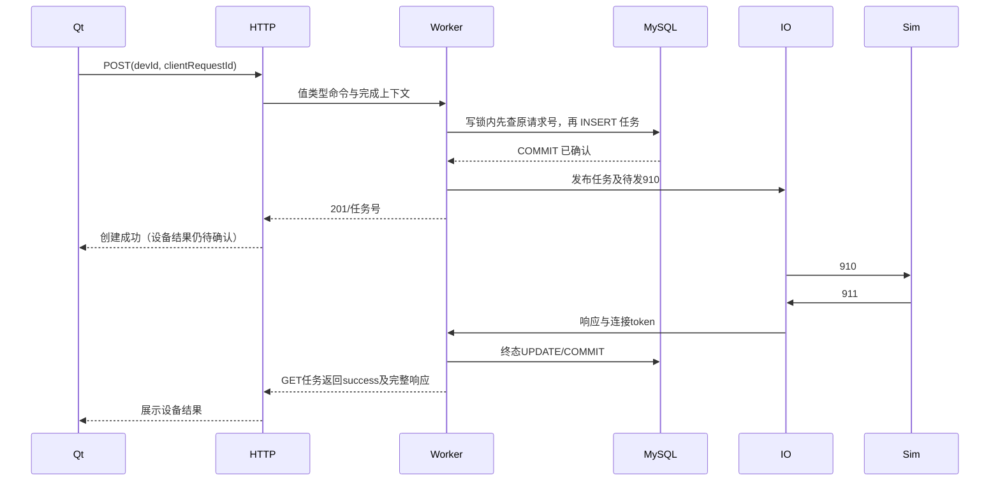

# 第三版核心路径讲解

## 正常主动查询

源码从 `http_api.cpp` → `api.hpp` → `access.cpp::drain_api` → `worker.cpp::command` → `store.cpp::create_api_query` 串读。HTTP 和 Qt 不直接访问 Worker map。事务和内存发布分开，提交后才允许安排 910。

## COMMIT 失败与未知结果

COMMIT 发出后连接断开，服务可能无法知道数据库是否已持久化。`MysqlConnection::commit` 抛出的 StorageError 带 `commit_unknown`，事务析构只尽力回滚，不把回滚尝试当成未提交证明。Worker 标记存储失败，服务停止受理并非零退出。

重启先持单实例锁、核对结构，再把旧 pending 标成 link_lost/server_restart。不会自动重发 910。`clientRequestId` 和任务同一行/同一事务，所以保留同一库时可以找回真实记录。

## HTTP 成功响应丢失

服务已提交任务但 HTTP 响应丢失时，Qt 不换请求号。若已有 txnNo，优先 GET；若尚无 txnNo，POST 原 clientRequestId。Store 在 busy 等创建判断之前查原号，同设备返回原任务 200，跨设备返回 409。新拒绝不占号。

这保证保留记录范围内的创建去重；不能把“终端操作恰好一次”当作交付能力。

## 生命周期与线程

`MysqlLibrary` 在主线程创建并最后清理。每个 Worker 在自己的线程中创建 MysqlThread TLS、Store 和连接，先关闭 Store 再清理 TLS。语句禁止复制，绑定缓冲由语句持有，读取先缓冲结果再允许同连接嵌套查询。

Qt 的控件、QNetworkAccessManager、reply 和定时器都留在 GUI 线程。回调携带页面 generation；切页递增 generation 并取消旧请求。自动刷新不叠加，任务轮询终态或观察期限到达后停止。观察期限是客户端停止等待，不是服务端任务终态。
