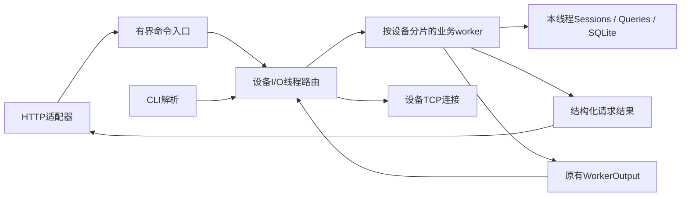

# 第二版实施方案与验收清单：HTTP运维与可靠请求

日期：2026-10-23。状态：V2/2.0.0已完成，V2-A/B/C及下列12项均已验收。证据见[第二版验收记录](第二版验收记录.md)。

已讨论确定：主线为C++服务端能力；调用方是本机运维脚本或通过SSH隧道访问的工具；先按价值和验收确定范围，再估算投入时间。第一版的学习注释和验收记录保留。

## 1. 第二版交付什么

场景：测试平台通过HTTP查看电池终端状态、发起只读参数查询、取回结果和检索告警。请求可能并发、超时或重试，服务必须给出明确的受理结果并保持任务一致性。

第一版已经是服务端，也已有异步查询。本版新增的是结构化调用入口、请求生命周期、持久化去重和有界检索；不是重新实现设备协议或增加一套查询状态机。

必做：四类HTTP接口、HTTP/CLI共用业务入口、请求与响应关联、查询请求去重、告警分页、故障回归及测量基线。

保留：C++17、现有Ubuntu/GCC/CMake、epoll LT设备接入、固定分片worker、SQLite、现有协议和CLI。只查询保护参数，不新增设备控制/改参功能。

本版不做：公网部署、用户/租户系统、JWT/TLS接入、前端页面、Redis/MySQL/消息队列、通用线程池、ROS2、严格按入队时刻判定911、无损背压。eventfd仅作核心验收后的可选优化，不是交付条件。

HTTP仅绑定Ubuntu的127.0.0.1，建议端口19002，显式启用；未启用HTTP时仍能运行V1用法。Windows通过已有SSH端口2222建立本地转发，不新增VirtualBox业务端口映射。本版依赖SSH认证与可信本机用户边界，不提供多用户权限隔离。

## 2. 接口与任务语义

| 接口 | 请求 | 成功结果 |
| --- | --- | --- |
| GET /v1/devices/{devId} | 一个设备编号 | 200：当前状态、属性、告警计数；沿用V1新鲜度语义 |
| POST /v1/queries | JSON：devId、clientRequestId | 新任务201；相同请求重试200；均返回任务编号与当前状态 |
| GET /v1/queries/{txnNo} | 正整数任务编号 | 200：数据库中的任务状态、reason、完整response及UTC毫秒时间 |
| GET /v1/alarms | 必填devId；可选status、limit、beforeId | 200：告警列表及nextBeforeId；status仅open/cleared |

不增加跨分片设备列表API，第一版devices命令继续可用。task读取已提交的数据库记录，不能用HTTP线程直接读取Queries缓存。

devId沿用V1校验；POST只接受上述两个字符串字段。txnNo和beforeId必须为1到INT64_MAX的十进制正整数，limit范围1—50；非法类型、重复/未知业务参数和溢出均拒绝。最后一页的nextBeforeId为null；GET设备不存在时与“已有档案但offline”明确区分。

POST示例：

```json
{"devId":"BT000","clientRequestId":"lab-20261023-0001"}
```

新任务事务提交后返回：

```json
{"clientRequestId":"lab-20261023-0001","txnNo":101,"state":"pending","replayed":false}
```

同时设置Location: /v1/queries/101。201表示任务资源已创建，不表示设备已返回参数；随后GET查询终态。本方案选择201资源创建语义，不把HTTP连接保持到设备查询结束。[HTTP 201语义](https://www.rfc-editor.org/rfc/rfc9110.html#name-201-created)

沿用V1：未知设备返回404且不建任务；已有档案但不在线/不fresh时创建link_lost终态任务并返回201，不发送910；同设备已有pending时新请求返回409。终态仍为success/timeout/link_lost，迟到不翻案。CLI查询也受同设备唯一pending约束。

业务错误统一JSON，至少包含error.code和message；POST错误还回显已合法解析的clientRequestId。参数/JSON错误400，未知设备/任务404，已知资源方法错误405并给出Allow，设备busy或请求号冲突409，body过大413，不支持的POST媒体类型415，应用队列忙/停止/应用等待超时503。

HTTP库在路由前拒绝的坏报文、连接队列超限等情况，允许协议错误响应或断开；不承诺所有传输层拒绝都有JSON。客户端错误与业务冲突不能触发storage_error或导致整个服务退出；真实关键存储故障继续遵守V1回滚、停止受理和非零退出规则，响应来不及发出时允许断开。

### 两种期限要分开

- 应用等待预算建议1秒：从进入HTTP handler并完成基本解析起，包含命令排队、worker处理、SQL提交和等待结构化结果；不包含设备911等待。
- 设备查询仍为3秒：从worker实际创建查询起算，包括提交和发送等待，按worker处理911时刻判断；HTTP请求提前排队不改变这个定义。
- 设备查询的deadline不因HTTP连接断开、重复POST或GET轮询而延长。HTTP断开不自动撤销已经提交的任务。
- 工作尚未开始且应用期限已过，可以跳过；一旦开始关键提交，不以客户端离开为由发布半份状态。响应超时不证明事务未提交。
- POST等待超时如仍能响应，返回503及outcome=unknown，提示使用相同clientRequestId重试；绝不能让客户端因此换新请求号。已确定未入队的拒绝可以标记outcome=not_created。

### 去重范围与数据库变化

clientRequestId为服务全局请求号，ASCII字母/数字/短横线/下划线，1—64字节，建议调用方使用UUID等不碰撞的值。它不同于每次HTTP调用的内存关联号，也不同于设备上报txnNo。只支持当前一种固定查询操作，因此请求内容等价性按校验后的devId比较，不按原始JSON空格或字段顺序比较。

| 情况 | 规定 |
| --- | --- |
| 新请求号、合法设备、可创建任务 | 任务与请求号在同一事务提交；提交后更新缓存并允许投递910 |
| 同请求号、同设备，无论任务pending或已终结 | 200返回同一txnNo和当前持久化状态，replayed=true；不再发送910 |
| 同请求号、不同设备 | 409 request_id_conflict；原任务不变 |
| 首次请求被参数校验、not_found或busy拒绝 | 不创建任务，也不持久化该错误；稍后相同请求号可以重试 |
| 提交前崩溃 | 回滚；同请求号重试可以创建一次任务 |
| 提交后未回HTTP响应就崩溃 | 重启后同请求号返回原任务；旧pending按V1恢复为link_lost/server_restart |

去重保证限于同一数据库中仍保留的任务记录；不承诺删库、回退备份或删除对应历史记录后仍记得请求号。本版不开发自动清理策略。

已实现将SQLite schema user_version从1迁移到2：为query_task增加可空client_request_id；对非NULL值建全局唯一索引。CLI任务及V1历史行该列为NULL；保留原AUTOINCREMENT、外键和唯一pending约束。告警检索增加匹配dev_id/id及dev_id/status/id的索引。DDL、版本更新在同一启动事务中完成，兼容新建库及已有V1库，不支持降级覆盖。

执行顺序必须保证：先识别已存在请求号，再判断同设备busy；并在公共写锁覆盖的事务内复查请求号，处理两个分片同时使用同一请求号的情况。事务返回created/replayed/conflict/rejected等明确结果；只有created才能发布新内存任务及生成910。

这是现有实现需要重构的重点：Queries::begin目前先查pending再调用分配回调，Store::write目前将所有异常视为存储失败。不能直接套用它们而把正常去重冲突变成致命错误，也不能先插task再另存请求号。

## 3. 线程边界、容量与退出



HTTP候选库为cpp-httplib。它使用阻塞socket I/O，HTTP处理线程只负责协议适配和有限等待；设备侧仍由现有epoll线程负责。库自带的HTTP执行线程不等于本项目实现了通用业务线程池。[上游README](https://github.com/yhirose/cpp-httplib)

已完成cpp-httplib v0.63.0的选型准入，记录见第二版验收记录；准入要求为：核对一个发布tag在GCC7.4/CMake3.10上的编译，验证固定线程数、有界待处理连接、报文上限、读写超时及停止时解除阻塞；通过后记录版本、来源、许可和SHA-256并随源码提供。已固定版本、许可和哈希，保留生命周期访问权限补丁；不拉浮动master，也未升级现有系统。

实现约束：

1. HTTP线程不访问普通业务map、不调用运行时SQLite、不操作设备fd，也不执行CLI子进程或解析stdout作为响应。
2. HTTP转换为带类型的Command，经有界入口让I/O路由。CLI和HTTP调用同一业务处理逻辑，格式化输出分别负责；不是维护两份状态机。
3. 每次调用有独立、进程内唯一的关联号与共享生命周期上下文。HTTP等待的是该请求的结构化结果，不是日志事件；不能把Request/Response引用或HTTP fd交给worker保存。
4. 关联上下文必须在超时后安全释放。晚到结果可丢弃响应，但不能访问已析构对象、重复完成promise或回给下一条连接。上下文数量受入口/业务队列和在处理请求数约束，不建无界等待表。
5. I/O继续独占原有WorkerOutput消费；HTTP线程不能抢取该队列，否则可能吞掉设备910、绑定或关闭操作。API结果通过独立的一次性结果通道返回；设备操作继续走原队列。
6. GET设备状态按设备路由；GET任务可由一个worker查库；告警查询要求devId并路由对应worker。预期业务拒绝使用结构化结果，不能落入worker的全局异常退出分支。

建议起始限制如下，属于本版验收配置，不是吞吐承诺；选型准入后若需调整，须先同步本方案和测试：

| 项目 | 起始限制 |
| --- | --- |
| HTTP处理线程 | 固定2条；关闭库默认动态扩容 |
| HTTP待处理连接 | 最多8条，不能保留默认无界配置；超限可直接断开 |
| HTTP至I/O命令入口 | 最多16条；满则立即拒绝，不阻塞I/O或持有SQL锁等待 |
| HTTP报文 | 头部总量16KiB、body 4KiB；不提供上传/流式接口；关闭持久连接复用以减少首版复杂度 |
| HTTP响应 | 最大256KiB；完整查询response_json仍须保留，不能静默裁剪 |
| 读写与等待 | 接收/发送无进展超时2秒，应用等待预算1秒；前者不能冒充总请求期限 |
| 告警分页 | 默认20、最大50；非法limit拒绝，不自动变成无限查询 |

告警按SQL全局id降序，下一页使用最后一条的id作为beforeId，条件id < beforeId。只拼固定SQL结构，参数全部绑定；不允许任意SQL/sort参数。每页最多取limit+1判断是否还有下一页。新增记录不会把已经取过的id推到下一页，但不同页间的告警状态可能变化；不承诺跨多页数据库快照。

关闭顺序：先关闭HTTP应用入口和监听，停止新受理；唤醒HTTP等待者并拒绝尚未开始的请求；I/O继续路由/排空已受理工作和设备结果；worker结束pending并关闭SQLite；最后回收HTTP线程及关联上下文。不能先在I/O线程join仍等待worker的HTTP线程。正常退出沿用5秒预算，慢传连接也必须能在停止时被关闭；库准入须实测这一点。

开发和迁移先使用独立V2测试库。已有手动库先通过SQLite Backup API备份再验证迁移；写方案阶段不动库。V1程序会拒绝schema2，回退应使用迁移前备份，不把新版库直接交给旧程序。

## 4. 按三段实施，每段通过后继续

| 阶段 | 工作 | 本段完成标准 |
| --- | --- | --- |
| V2-A：接通入口 | 完成HTTP库准入；定义Command/Result与请求上下文；实现GET设备、GET任务；CLI复用业务入口 | curl/Python可取得结构化结果；并发响应不串；HTTP关闭/超时不悬空；V1回归通过 |
| V2-B：可靠创建 | schema2迁移；POST异步查询；请求号与任务原子提交；重试去重；区分应用与设备期限 | 并发同号只建一个任务；同号跨设备冲突不退出；提交前后崩溃、丢响应后重试均正确；V1回归通过 |
| V2-C：有界检索与交付 | 告警筛选/游标分页；过载/停止/存储故障；结构化日志与测量；一键演示、教程和记录 | 全部验收项通过，留下原始证据；完成普通及适用检测构建；现有模拟器仍能使用 |

三段均已完成；实现过程、依赖准入和原始结果见第二版验收记录。未预设日历工期或性能收益比例。

### 验收清单（已执行，证据见第二版验收记录）

- [x] V2-01：同机/SSH隧道可访问四类接口，仅回环监听；HTTP未启用时V1正常运行。
- [x] V2-02：设备快照、完整查询结果、错误码及Location符合本方案；客户端错误不终止服务。
- [x] V2-03：HTTP和CLI共用业务逻辑；不同请求并发、超时和晚到响应不串请求，不跨线程操作普通业务容器或SQLite连接。
- [x] V2-04：POST提交后才返回创建成功，入库前不发910；HTTP断开不撤销已提交任务，轮询不延长期限。
- [x] V2-05：同号同内容并发/终态后/重启后重试均返回原txnNo，不再发910；同号不同内容返回409，尤其覆盖跨分片竞争。
- [x] V2-06：事务提交前崩溃、提交后丢响应、写入失败回滚三类场景正确；不出现只存task或只存请求号的半份记录。
- [x] V2-07：告警筛选、空页、游标边界和非法参数正确；新增记录时分页无重复id，SQL和返回结果有界。
- [x] V2-08：HTTP慢请求、连接队列满、应用队列满、worker忙和停止期间等待均有明确结果/断开边界；设备I/O还能推进，无无限积压。
- [x] V2-09：V1库副本迁移/新建库/schema2重启均通过；保留旧任务、告警、时间与自增序列；迁移失败不开监听且无半个DDL。
- [x] V2-10：V1既有7组及V2新增测试通过；ASan/UBSan和适用TSan执行，沿用并说明现有SQLite特定WAL位置抑制，不扩大抑制范围。
- [x] V2-11：一键复现“创建→断开/丢响应→同号重试→原任务→终态→重启再查询”；教程包含Linux调用与Windows SSH转发。
- [x] V2-12：记录轻负载、持续上报、短时突发三类负载，给出HTTP时延、CPU/峰值内存、队列峰值和拒绝/断开数；区分新建、重放、busy及失败，不用快速错误响应冒充高吞吐。

每段保留可复现命令、输入、预期、实际和原始日志；测量记录机器、版本、配置、设备数、上报频率、HTTP并发及持续时间。先验证正确性，再记录基线；不设固定收益比例，不把虚拟机模拟结果称为现场验证。

验收后可研究eventfd：只改变HTTP命令/worker结果通知机制，对照固定轮询与主动唤醒的空闲CPU和通知延迟。数据表明有价值再纳入后续小版本；本版不同时重构背压、业务线程池或数据库。
